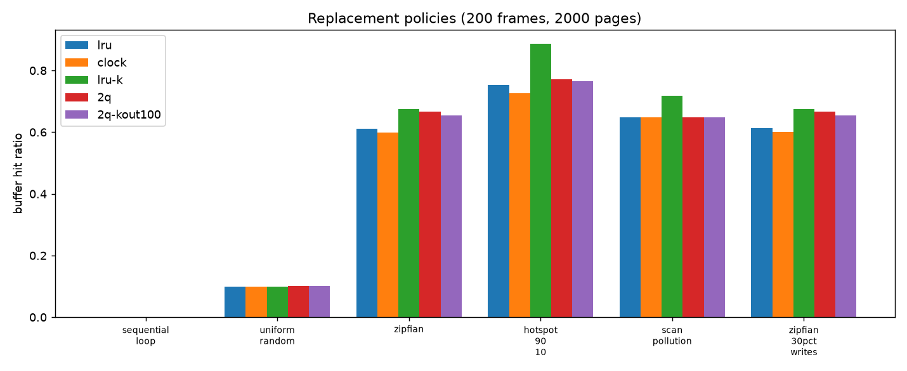
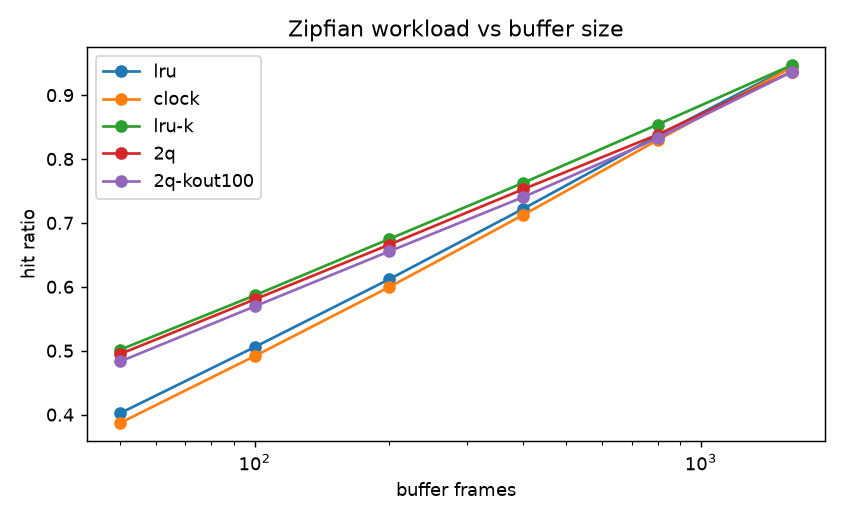
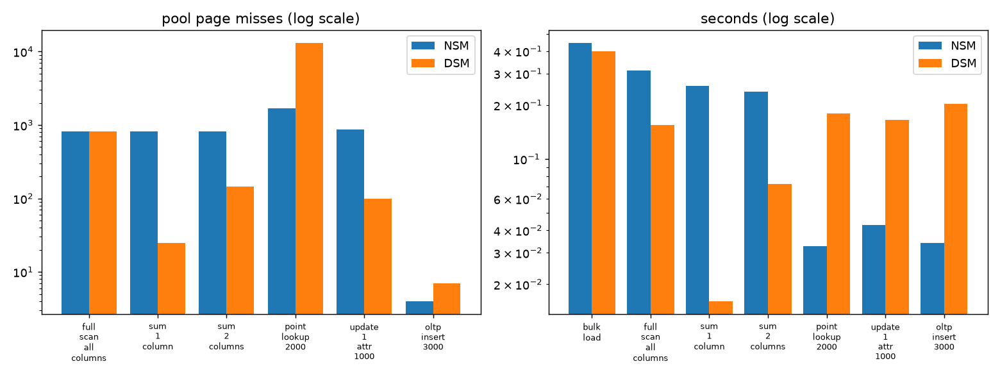

# CoreDB Storage & Buffer Pool Benchmark Analysis

## 1. Executive Summary

This report evaluates the performance of **CoreDB (`v0.1.0`)** across two fundamental database engine subsystems:

1. **Buffer Pool Replacement Policies:** Comparing `LRU`, `CLOCK`, `LRU-K` ($k=2$), `2Q`, and `2Q-kout100` across six distinct page-access traces and six buffer pool capacities.

2. **Storage Layouts:** Comparing row-oriented **N-ary Storage Model (NSM)** against column-oriented **Decomposition Storage Model (DSM)** across analytical scans, point lookups, updates, and OLTP inserts.

### Key Findings

* **Scan-Resistant Policies Win on Skewed Workloads:** `LRU-K` ($k=2$) and `2Q` consistently outperform traditional `LRU` and `CLOCK` on skewed (`Zipfian`, `Hotspot 90/10`) and mixed (`Scan Pollution`) workloads. Notably, `LRU-K` achieves an $88.71\%$ **hit ratio** on the `Hotspot 90/10` trace (vs. $75.37\%$ for `LRU`) and is the **only policy** that prevents cache pollution during periodic sequential scans ($71.75\%$ vs. $64.75\%$).

* **CPU Overhead vs. I/O Reduction:** While `LRU-K` yields the highest hit ratios, its history-tracking overhead makes it the slowest in pure in-memory execution time. `2Q` strikes the best balance, achieving near-identical hit ratios to `LRU-K` while maintaining execution times faster than or equal to `LRU`.

* **DSM Dominates Analytical Aggregations:** For single-column aggregations (`sum_1_column`), DSM reduces page misses by $96.9\%$ ($25$ vs. $819$ misses) and executes $15.9\times$ **faster** than NSM ($0.0161\text{s}$ vs. $0.2557\text{s}$).

* **NSM Dominates OLTP & Tuple Reconstruction:** For multi-column point lookups (`point_lookup_2000`), DSM suffers from tuple reconstruction overhead across separate column pages, resulting in $7.7\times$ **more page misses** ($13,012$ vs. $1,691$) and $5.5\times$ **slower latency** ($0.1790\text{s}$ vs. $0.0326\text{s}$) than NSM.

## 2. Test Environment & Methodology

All benchmarks were executed deterministically using fixed random seeds against the real `BufferPool` and `DiskManager` implementations (measuring actual page reads, writes, and evictions rather than simulations).

* **Hardware & OS:** Windows 11 (`10.0.26220-SP0`), AMD64 Architecture, $8$ CPU cores

* **Runtime:** Python `3.13.0`, CoreDB `0.1.0`

* **Page Size:** $4,096\text{ bytes}$ ($4\text{ KB}$)

## 3. Buffer Pool Replacement Policy Analysis

### 3.1 Experimental Setup

* **Database Size:** $2,000\text{ pages}$ ($8.19\text{ MB}$)

* **Trace Length:** $60,000\text{ page accesses}$ (`seed = 42`)

* **Default Buffer Pool Size:** $200\text{ frames}$ ($10\%$ of database size)

* **Policies Evaluated:** `lru`, `clock`, `lru-k` ($k=2$), `2q` (default $K_{out}$ ratio), and `2q-kout100` ($K_{out}$ ratio $= 1.0$)

### 3.2 Performance Across Access Patterns (200 Frames)

| Workload Pattern | Metric | `LRU` | `CLOCK` | `LRU-K (k=2)` | `2Q` | `2Q-kout100` | 
| ----- | ----- | ----- | ----- | ----- | ----- | ----- | 
| **Sequential Loop** | Hit Ratio | $0.00\%$ | $0.00\%$ | $0.00\%$ | $0.00\%$ | $0.00\%$ | 
| *(Full table scan* $\times 30$*)* | Time (s) | $0.581$ | $0.564$ | $0.795$ | $0.558$ | $0.455$ | 
| **Uniform Random** | Hit Ratio | $9.82\%$ | $9.82\%$ | $9.95\%$ | $10.04\%$ | $10.17\%$ | 
| *(No locality)* | Time (s) | $0.475$ | $0.460$ | $0.691$ | $0.504$ | $0.565$ | 
| **Zipfian (**$s=1.0$**)** | Hit Ratio | $61.16\%$ | $59.93\%$ | $67.46\%$ | $66.57\%$ | $65.53\%$ | 
| *(Read-only skew)* | Disk Reads | $23,303$ | $24,040$ | $19,526$ | $20,056$ | $20,681$ | 
|  | Time (s) | $0.279$ | $0.253$ | $0.355$ | $0.241$ | $0.248$ | 
| **Hotspot (90/10)** | Hit Ratio | $75.37\%$ | $72.61\%$ | $88.71\%$ | $77.17\%$ | $76.63\%$ | 
| *(*$90\%$ *accesses in* $10\%$ *pages)* | Disk Reads | $14,776$ | $16,431$ | $6,772$ | $13,699$ | $14,019$ | 
|  | Time (s) | $0.189$ | $0.190$ | $0.219$ | $0.186$ | $0.190$ | 
| **Scan Pollution** | Hit Ratio | $64.75\%$ | $64.75\%$ | $71.75\%$ | $64.75\%$ | $64.75\%$ | 
| *(*$150$ *hot +* $600$*-page scans)* | Disk Reads | $21,150$ | $21,150$ | $16,950$ | $21,150$ | $21,150$ | 
|  | Time (s) | $0.277$ | $0.211$ | $0.281$ | $0.212$ | $0.215$ | 
| **Zipfian (30% Writes)** | Hit Ratio | $61.33\%$ | $60.10\%$ | $67.48\%$ | $66.66\%$ | $65.49\%$ | 
| *(Dirty page flushes)* | Disk Writes | $8,356$ | $8,817$ | $6,562$ | $6,618$ | $7,077$ | 
|  | Time (s) | $0.307$ | $0.310$ | $0.386$ | $0.282$ | $0.303$ | 

#### Workload Observations

1. **Pathological Workloads (`Sequential Loop` & `Uniform Random`):**

   * Because the loop ($2,000$ pages) exceeds the buffer capacity ($200$ frames), every policy experiences $100\%$ misses ($60,000$ reads, $59,800$ evictions).

   * Under `Uniform Random`, hit ratios converge near the theoretical cache-to-database ratio ($200 / 2000 = 10.0\%$).

2. **Scan Resistance (`Scan Pollution`):**

   * The working set consists of $150$ hot pages, interrupted every $1,500$ accesses by a sequential scan of $600$ cold pages.

   * `LRU` and `CLOCK` allow the $600$-page scan to completely flush the $150$ hot pages from the $200$-frame pool. Interestingly, `2Q` also falls to $64.75\%$ here—likely because its $A1_{in}$ FIFO queue size ($25\%$ of $200 = 50$ frames) or promotion behavior allows scan pages to disrupt the hot set under this specific cadence, whereas **`LRU-K` (**$k=2$**)** refuses to evict pages with two recent accesses in favor of one-hit scan pages, boosting hit ratio by $+7.00\%$ ($4,200$ fewer disk reads).

3. **Hotspot & Write Amplification (`Hotspot 90/10` & `Zipfian 30% Writes`):**

   * In `Hotspot 90/10`, the $200$ hot pages fit *exactly* inside the $200$-frame buffer. `LRU-K` retains nearly the entire hot set ($88.71\%$ hit ratio, approaching the theoretical ceiling of $90\%$), cutting disk reads by $54.2\%$ compared to `LRU` ($6,772$ vs. $14,776$).

   * Under `Zipfian 30% Writes`, keeping hot pages resident in memory directly reduces dirty-page writeback traffic: `LRU-K` and `2Q` reduce `disk_writes` by $21.5\%$ ($6,562$ vs. $8,356$) and $20.8\%$ ($6,618$ vs. $8,356$) respectively compared to `LRU`.

### 3.3 Sensitivity to Buffer Pool Size (Zipfian Workload)

Evaluating the `Zipfian` workload across buffer capacities ranging from $2.5\%$ ($50$ frames) to $80\%$ ($1,600$ frames) of the database size reveals how policy advantages scale with memory availability:

| Buffer Frames (% of DB) | `LRU` | `CLOCK` | `LRU-K (k=2)` | `2Q` | `2Q-kout100` | Max Advantage over `LRU` | 
| ----- | ----- | ----- | ----- | ----- | ----- | ----- | 
| **50** ($2.5\%$) | $40.23\%$ | $38.71\%$ | $50.16\%$ | $49.48\%$ | $48.32\%$ | $+9.93\%$ (`LRU-K`) | 
| **100** ($5.0\%$) | $50.56\%$ | $49.15\%$ | $58.65\%$ | $58.02\%$ | $56.93\%$ | $+8.09\%$ (`LRU-K`) | 
| **200** ($10.0\%$) | $61.16\%$ | $59.93\%$ | $67.46\%$ | $66.57\%$ | $65.53\%$ | $+6.30\%$ (`LRU-K`) | 
| **400** ($20.0\%$) | $72.21\%$ | $71.25\%$ | $76.27\%$ | $75.27\%$ | $74.04\%$ | $+4.06\%$ (`LRU-K`) | 
| **800** ($40.0\%$) | $83.65\%$ | $82.96\%$ | $85.39\%$ | $83.81\%$ | $83.24\%$ | $+1.74\%$ (`LRU-K`) | 
| **1600** ($80.0\%$) | $94.51\%$ | $94.36\%$ | $94.69\%$ | $93.65\%$ | $93.65\%$ | $+0.18\%$ (`LRU-K`) | 

* **Memory-Constrained Regimes (**$50$**–**$200$ **frames):** Frequency-aware policies (`LRU-K`, `2Q`) provide massive gains ($+6.3\%$ to $+9.9\%$ hit ratio) when cache space is scarce because they prevent single-access tail pages from evicting frequently accessed head pages.

* **Memory-Abundant Regimes (**$1,600$ **frames):** Once the buffer holds $80\%$ of the dataset, capacity misses vanish and all policies converge around $\sim 94.5\%$. Notably, `2Q` slightly trails `LRU` ($93.65\%$ vs. $94.51\%$) at $1,600$ frames due to static partitioning between its $A1_{in}$ and $A_m$ queues reserving frames for cold arrivals.

## 4. Storage Layout Analysis: NSM vs. DSM

### 4.1 Experimental Setup

* **Dataset:** $40,000\text{ rows}$ in table `order_items` (`seed = 7`, median of $3$ repeats)

* **Schema (**$8$ **columns):** `id` (INT), `order_id` (INT), `product_id` (INT), `quantity` (INT), `unit_price` (DECIMAL), `discount` (FLOAT), `status` (VARCHAR(12)), `note` (VARCHAR(80), $30\%$ NULL)

* **Buffer Configuration:** $128\text{ frames}$ ($512\text{ KB}$ pool) with `LRU` replacement—intentionally smaller than the $\sim 3.36\text{ MB}$ table to force cold-disk I/O behavior.

### 4.2 Storage Footprint & Bulk Load

| Metric | NSM (Row Store) | DSM (Column Store) | Difference (DSM vs. NSM) | 
| ----- | ----- | ----- | ----- | 
| **Bulk Load Time** | $0.4431\text{ s}$ | $0.4005\text{ s}$ | $-9.6\%$ **faster** | 
| **Data Pages** | $820\text{ pages}$ | $826\text{ pages}$ | $+6\text{ pages}$ ($+0.7\%$) | 
| **Logical Data Bytes** | $3,358,720\text{ B}$ | $3,383,296\text{ B}$ | $+24,576\text{ B}$ ($+0.7\%$) | 
| **Total File Bytes** | $3,375,104\text{ B}$ | $3,399,680\text{ B}$ | $+24,576\text{ B}$ ($+0.7\%$) | 

Both layouts exhibit virtually identical storage footprints ($\sim 3.36\text{ MB}$), with DSM requiring only $6$ additional pages due to per-column page alignment boundaries. DSM bulk loading is slightly faster ($0.4005\text{s}$ vs. $0.4431\text{s}$) due to contiguous column packing.

### 4.3 Query & Transaction Benchmark Results

| Operation | Workload Type | NSM Time (s) | DSM Time (s) | NSM Misses (Hit %) | DSM Misses (Hit %) | Winner & Speedup | 
| ----- | ----- | ----- | ----- | ----- | ----- | ----- | 
| **`full_scan_all_columns`** | Full Table Scan | $0.3106\text{ s}$ | $0.1554\text{ s}$ | $819$ ($0.00\%$) | $817$ ($0.00\%$) | **DSM (**$2.00\times$**)** | 
| **`sum_1_column`** | OLAP (1 Col) | $0.2557\text{ s}$ | $0.0161\text{ s}$ | $819$ ($0.00\%$) | $25$ ($68.33\%$) | **DSM (**$15.88\times$**)** | 
| **`sum_2_columns`** | OLAP (2 Cols) | $0.2371\text{ s}$ | $0.0728\text{ s}$ | $819$ ($0.00\%$) | $146$ ($8.33\%$) | **DSM (**$3.26\times$**)** | 
| **`point_lookup_2000`** | OLTP Point Read | $0.0326\text{ s}$ | $0.1790\text{ s}$ | $1,691$ ($15.45\%$) | $13,012$ ($18.67\%$) | **NSM (**$5.49\times$**)** | 
| **`update_1_attr_1000`** | Targeted Update | $0.0429\text{ s}$ | $0.1654\text{ s}$ | $862$ ($57.16\%$) | $100$ ($98.37\%$) | **NSM (**$3.86\times$**)** | 
| **`oltp_insert_3000`** | OLTP Insert | $0.0340\text{ s}$ | $0.2035\text{ s}$ | $4$ ($99.87\%$) | $7$ ($99.99\%$) | **NSM (**$5.99\times$**)** | 
| **`sort_by_price`** | Analytical Sort | *N/A* | $0.5276\text{ s}$ | *N/A* | $921$ ($65.79\%$) | *DSM-only op* | 

### 4.4 Architectural Trade-off Analysis

1. **Analytical Projection & Cache Locality (`sum_1_column` & `sum_2_columns`):**

   * In **NSM**, scanning `quantity` requires reading every row across all $820$ pages ($819$ misses, $0\%$ hit ratio) because `quantity` is interleaved with wide `VARCHAR` columns (`note`, `status`).

   * In **DSM**, all $40,000$ `quantity` integers fit into roughly $40$ pages. Over $3$ repeated runs, the first run incurs cold misses while subsequent runs hit the $128$-frame buffer pool ($68.33\%$ hit ratio, averaging just $25$ **misses per run**), delivering a $15.88\times$ **speedup**.

   * Even on `full_scan_all_columns` where both layouts incur $\sim 818$ page misses, DSM is $2.0\times$ **faster** ($0.1554\text{s}$ vs. $0.3106\text{s}$) due to tighter inner loops and lack of per-row tuple deserialization overhead.

2. **Tuple Reconstruction Penalty (`point_lookup_2000`):**

   * Fetching $2,000$ complete rows in **NSM** requires at most $1$ page fetch per row ($1,691$ misses after buffer hits).

   * In **DSM**, reconstructing a single $8$-column tuple requires probing $8$ separate column segments ($2,000 \times 8 = 16,000$ logical page accesses). Even with an $18.67\%$ hit ratio, this causes $13,012$ **page misses** ($7.7\times$ worse than NSM), illustrating the classic tuple-reconstruction bottleneck of pure column stores.

3. **I/O vs. CPU Divergence on Single-Column Updates (`update_1_attr_1000`):**

   * Updating `status` on $1,000$ rows demonstrates an insightful decoupling between page misses and wall-clock latency:

     * **DSM** touches *only* the `status` column pages, resulting in just $100$ **page misses** and a $98.37\%$ **hit ratio** (compared to $862$ misses and $57.16\%$ hit ratio in **NSM**, which must read and rewrite full rows).

     * However, **NSM completes** $3.86\times$ **faster** ($0.0429\text{s}$ vs. $0.1654\text{s}$). In CoreDB's Python implementation, `t.update_column()` incurs higher per-call Python/slotted-page manipulation overhead across $1,000$ individual calls than NSM's single in-place tuple update, outweighing DSM's $8.6\times$ reduction in page misses when disk I/O is simulated/OS-cached.

4. **OLTP Write Amplification (`oltp_insert_3000`):**

   * Inserting $3,000$ individual rows appends to a single tail page in **NSM** ($0.0340\text{s}$), whereas **DSM** must locate, pin, append, and unpin across $8$ separate column tail pages per row ($0.2035\text{s}$, $5.99\times$ **slower**).

## 5. Recommendations

1. **Default Buffer Replacement Policy:**

   * Adopt **`2Q`** as CoreDB's general-purpose default policy: it captures nearly all of `LRU-K`'s hit-ratio and write-reduction benefits on skewed workloads ($66.57\%$ vs. $67.46\%$ on Zipfian) while running $32\%$ **faster** in CPU time ($0.241\text{s}$ vs. $0.355\text{s}$).

   * Provide **`LRU-K` (**$k=2$**)** as a tunable option for workloads known to experience heavy sequential scan pollution alongside small hot working sets.

2. **Storage Layout Selection:**

   * Use **NSM** for transactional (OLTP) tables dominated by multi-column point lookups (`get`), single-row inserts, and full-record updates.

   * Use **DSM** for read-heavy analytical (OLAP) tables where queries project subsets of columns (`SUM`, `AVG`, filtering, sorting).

3. **Engine Optimization Opportunities:**

   * **Batching / Vectorization in DSM:** Optimizing `update_column` and `insert` to batch column mutations (or reducing per-call Python overhead in `DSM`) would allow DSM to translate its $8.6\times$ page-miss advantage on single-column updates into real wall-clock speedups.

   * **2Q Queue Tuning:** Inspecting `2Q`'s $A1_{in}$ threshold under `scan_pollution` could allow `2Q` to match `LRU-K`'s scan resistance without incurring `LRU-K`'s timestamp-tracking CPU overhead.